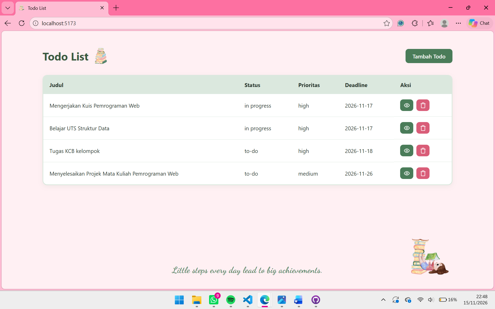
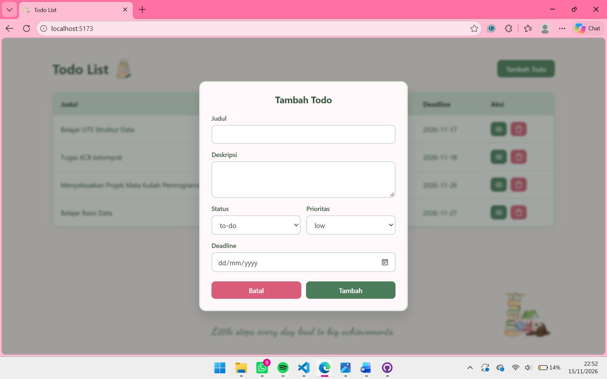
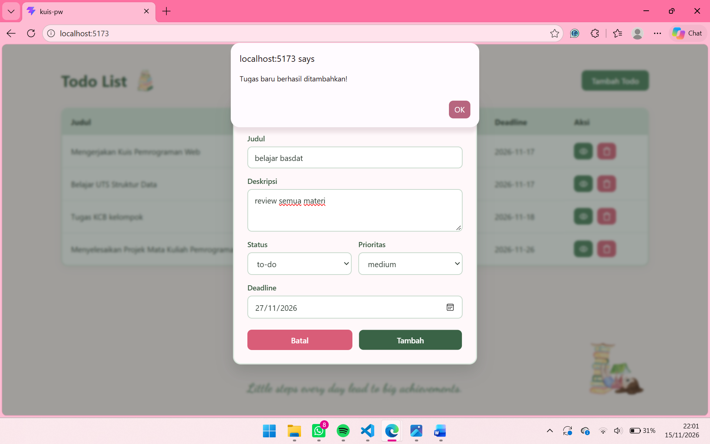
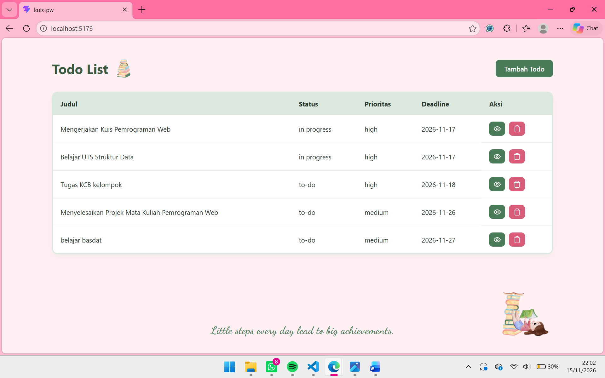
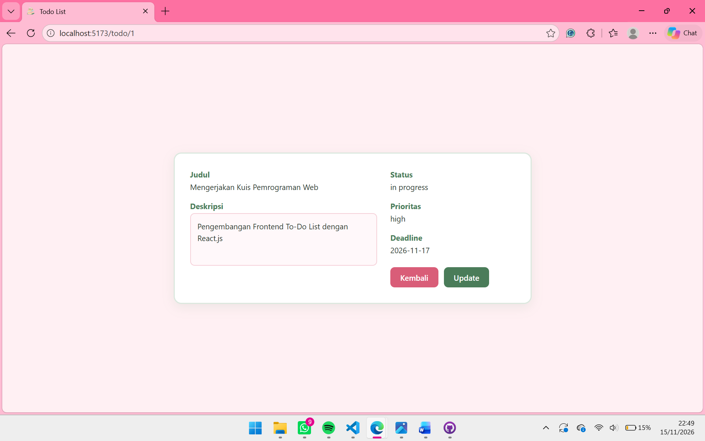
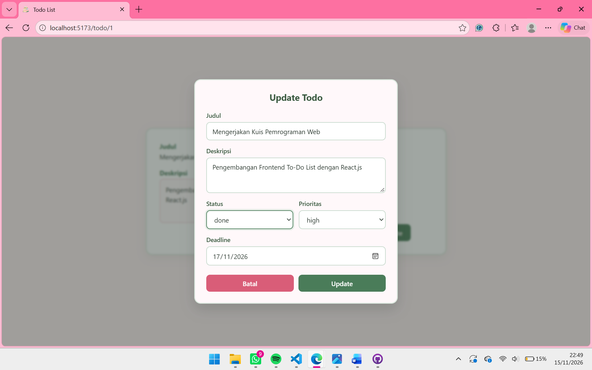
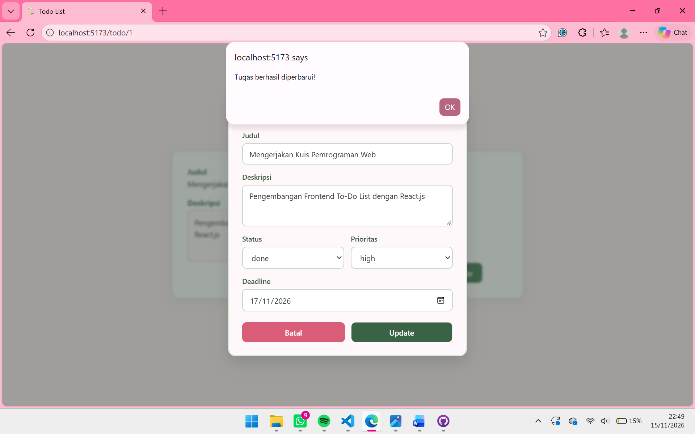
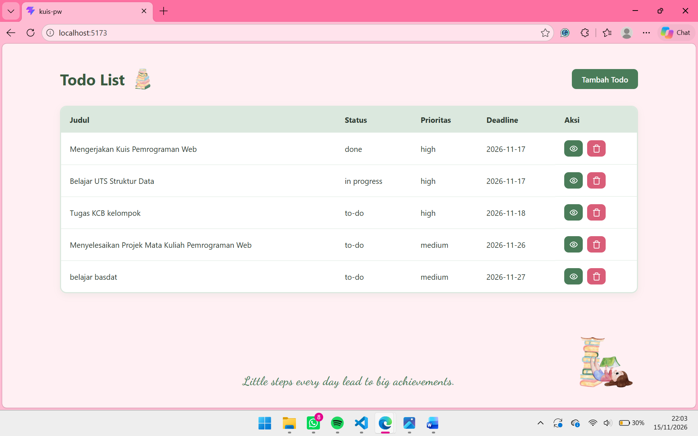
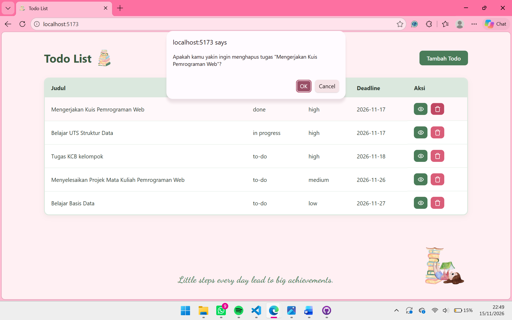
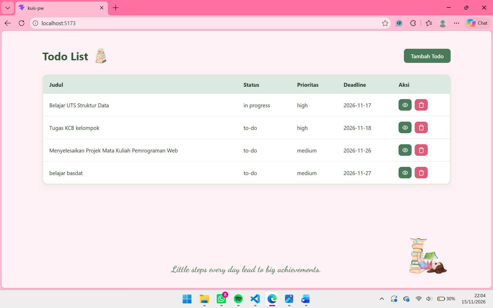

# Website To-Do List - Kuis Praktikum Pemrograman Web

Aplikasi To-Do List berbasis React.js menggunakan Vite dan React Router DOM.

## Screenshot Implementasi
### 1. Halaman Utama

### 2. Tambah Todo

### 3. Detail Tugas

### 4. Update Todo

### 5. Hapus Todo

